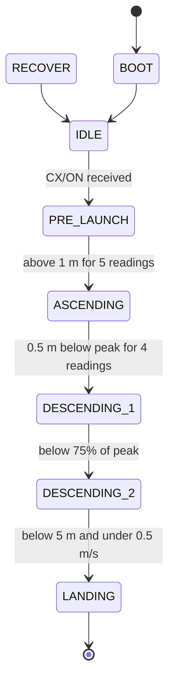

# CanSat Flight Software: Multithreaded Reference (Teensy 4.1)

A reference implementation of multithreaded CanSat flight software on a Teensy 4.1, written to help future CanSat teams get the structure right from day one.

> [!IMPORTANT]
> **This is not the software we flew at CanSat 2025.**
> It is a cleaned-up rewrite built on the same concept and architecture we used as Team UIU ASCEND, with the lessons we learned folded in. It has not been flight-tested. Treat it as a starting point and a learning resource, and bench-test everything on your own hardware before trusting it with a mission.

## Why this exists

Most CanSat flight software starts as one big `loop()`. That works until the GPS parser, the barometer, the radio, and the state machine start fighting over time. Moving to threads fixes the timing, but it brings a new class of bugs: race conditions, corrupted strings, stack overflows, and deadlocks. These bugs rarely show up on the bench and tend to appear mid-flight.

This repo shows one way to structure the software so each part runs on its own schedule **without** stepping on the others. The code is small enough to read in one sitting, and the threading rules below are the part we'd most like you to take away.

## Hardware

| Part | Role | Connection |
|---|---|---|
| Teensy 4.1 | Flight computer (600 MHz ARM Cortex-M7) | |
| BMP388 (Adafruit BMP3XX) | Pressure, altitude, temperature | I2C on `Wire1`, address `0x77` |
| GPS module (NMEA) | Position, GPS altitude, time, satellites | `Serial5`, 9600 baud |
| XBee 900HP | Radio link to the ground station | `Serial8` (TX8 = pin 35, RX8 = pin 34), 9600 baud |
| Voltage divider | Battery voltage | Analog pin 15, 5:1 ratio |

The telemetry packet has fields for gyro, accelerometer, magnetometer, and auto-gyro rotation rate. This reference leaves them at zero so the threading structure stays easy to follow. Add an IMU thread to fill them (see the threading rules about sharing the I2C bus).

## Architecture

Five threads run alongside the Arduino `loop()`. Each one owns its hardware and publishes its results for the others to read.

| Thread | Rate | Owns | Publishes |
|---|---|---|---|
| `altitudeThread` | 25 Hz | BMP388 | Altitude, peak, velocity, temperature, pressure |
| `gpsThread` | 10 Hz | GPS on `Serial5` | Latitude, longitude, GPS altitude, satellites, time |
| `commandThread` | 50 Hz | XBee reads | Telemetry on/off, command echo |
| `stateMonitorThread` | 10 Hz | Flight state | Current state |
| `telemetryThread` | 1 Hz | XBee writes, battery ADC | Telemetry packets |
| `loop()` | every 5 s | USB status report | |

### Flight states



All thresholds are constants at the top of `main.cpp`. Tune them to your own mission profile.

## Threading rules

These are the rules the code follows. If you extend it, keep following them.

1. **One lock per shared resource.** `serialLock` guards USB Serial, `xbeeLock` guards the radio, `gpsLock` guards the GPS snapshot, and `cmdLock` guards the command echo. Never use one serial port from two threads without its lock. The TeensyThreads documentation warns about exactly this.
2. **Shared numbers and flags are `std::atomic`.** A read-modify-write must be one atomic operation (`fetch_add`), never a `load()` followed by a `store()`.
3. **Lock with `Threads::Scope`, not manual `lock()`/`unlock()`.** The scope unlocks automatically, so an early `return` or `continue` can't leave a mutex locked.
4. **Keep critical sections short.** Copy the data out, release the lock, then do the slow work (printing, building strings) on your copy. Never call `threads.delay()` while holding a lock.
5. **Never hold two locks at once.** TeensyThreads mutexes aren't recursive, so locking the same mutex twice from one thread deadlocks it.
6. **One writer per value.** Each value has exactly one thread that writes it. Others only read.
7. **Start order is not priority.** TeensyThreads schedules round-robin. To give a thread more CPU time, use `threads.setTimeSlice(id, ticks)`.
8. **Give every thread a real stack.** The default is 1024 bytes. Threads that use `String` or print to Serial can overflow that, and a stack overflow corrupts memory in ways that look exactly like a race condition. This code gives each thread 4096 bytes.

## Ground station protocol

**Handshake.** On power-up, the CanSat sends `<A3158GCS>` every 2 seconds until the ground station replies `<A3158ACK>`. Threads start only after that.

**Commands.** Framed as `<C` + command + `>`:

| Frame | Effect |
|---|---|
| `<CCX/ON>` | Start telemetry and arm the state machine (IDLE to PRE_LAUNCH) |
| `<CCX/OFF>` | Stop telemetry |

**Telemetry.** One packet per second while telemetry is on, framed as `<T` ... `>` with comma-separated fields:

```
TEAM_ID, MISSION_TIME, PACKET_COUNT, MODE, STATE, ALTITUDE, TEMPERATURE,
PRESSURE, VOLTAGE, GYRO_R, GYRO_P, GYRO_Y, ACCEL_R, ACCEL_P, ACCEL_Y,
MAG_R, MAG_P, MAG_Y, AUTO_GYRO_ROTATION_RATE, GPS_TIME, GPS_ALTITUDE,
GPS_LATITUDE, GPS_LONGITUDE, GPS_SATS, CMD_ECHO,
```

Altitude is in metres relative to the launch pad. Packet count starts at 1. Mission time is time since power-on.

## Building

With [PlatformIO](https://platformio.org/):

```bash
pio run              # build
pio run -t upload    # flash the Teensy
pio device monitor   # USB debug output at 115200 baud
```

TeensyThreads ships with the Teensy Arduino framework. The other libraries are listed in `platformio.ini`.

## Lessons from CanSat 2025

- **Design the threading model before writing features.** Retrofitting locks into working code is where most of our bugs came from.
- **Bench-test the whole state machine, not just the sensors.** Walk the CanSat through every state on the bench, including the ones that need a command from the ground station. A state machine that can't leave IDLE looks perfectly fine until you try to launch.
- **Keep units in the names or the comments.** Mixing centimetres and metres in one comparison is an easy mistake and a silent one.
- **Every value you send should come from somewhere real.** If a field always shows a default, the code that fills it probably never runs.
- **Use version control from the first line.** You'll want to know exactly what changed between the test that worked and the one that didn't.

## Known limitations

- **Not flight-tested.** This is a reference, not proven flight software.
- **No state persistence.** After a reset, the CanSat restarts at BOOT instead of resuming its flight state. A competition build should save the state and packet count to EEPROM and restore them on boot, which is what the `RECOVER` state is for.
- **IMU fields are zero.** Add an IMU thread and a `Wire1` lock if it shares the bus with the BMP388.
- **Heavy use of Arduino `String`.** Fine for a reference, but long missions are safer with fixed-size `char` buffers that avoid heap allocation.
- **Mission time is uptime,** not UTC from the GPS.

## Credits

Built on the concept behind the flight software of **Team UIU ASCEND**, United International University, Bangladesh. CanSat 2025: 7th worldwide, 2nd in Asia, 1st in Bangladesh.

Reference implementation by [Rayian Mahi](https://github.com/xrayian).
